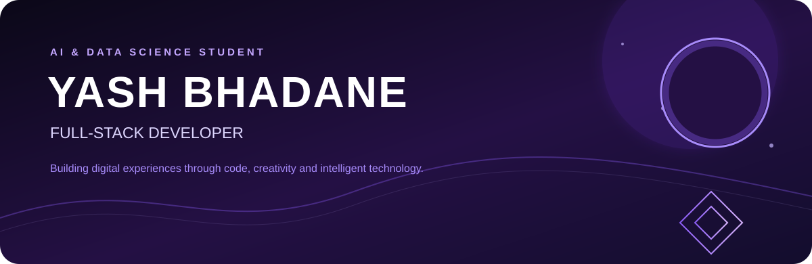
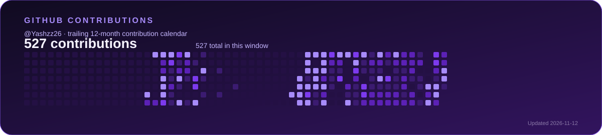
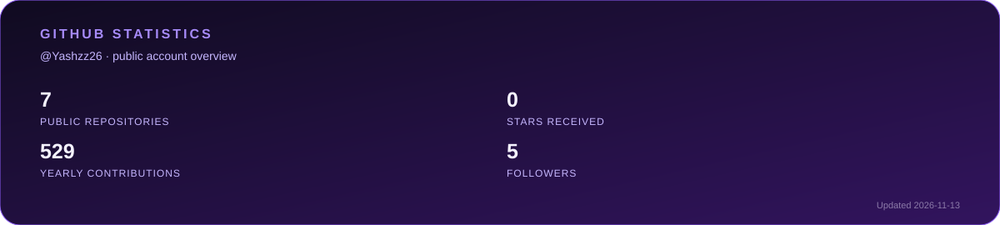
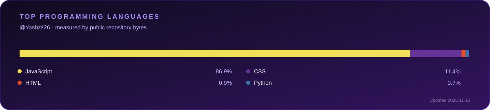
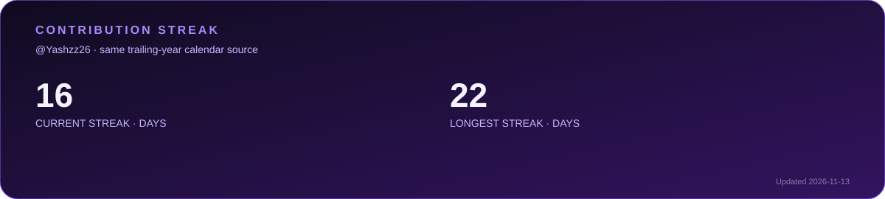
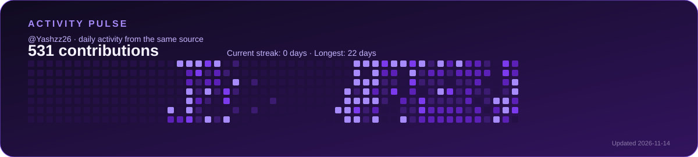

  
  
  

  
  
  
  

## About me

I’m **Yash Bhadane**, an **Artificial Intelligence & Data Science** student at **D. Y. Patil College of Engineering, Akurdi**. I build polished full-stack experiences with **React, JavaScript, Node.js and Firebase**, while exploring AI/ML and data science through hands-on projects.

## Featured projects

<table>
<tr>
<td width="50%" valign="top">

### [Jewellery Store ↗](https://jewellery-frontend-zeta.vercel.app/)
Elegant e-commerce storefront focused on product discovery and refined shopping flows.

`LIVE` · React · E-commerce

</td>
<td width="50%" valign="top">

### [IronPeak Gym ↗](https://ironpeak-gym.vercel.app/)
High-energy gym experience with clear plans, strong visual hierarchy and conversion-focused UI.

`LIVE` · Frontend · Product UI

</td>
</tr>
<tr>
<td width="50%" valign="top">

### [L'Arora Studio ↗](https://larora-studio.vercel.app/)
Modern furniture and interior design website showcasing products with an elegant browsing experience.

`LIVE` · React · Vercel

</td>
<td width="50%" valign="top">

### [Luxe Estate ↗](https://luxe-estate-liart-two.vercel.app/)
Premium real estate experience for property listings and modern property discovery.

`LIVE` · React · Vercel

</td>
</tr>
<tr>
<td width="50%" valign="top">

### Chronix Watch Store
Watch e-commerce platform with product discovery, authentication, shopping functionality and modern UI.

`IN DEVELOPMENT` · E-commerce · Full-stack

</td>
<td width="50%" valign="top">

### Gym Management System
Multi-role platform for members, staff, attendance, online joining and gym operations.

`IN DEVELOPMENT` · Full-stack · Management

</td>
</tr>
<tr>
<td width="50%" valign="top">

### Cubex
Interactive Rubik’s Cube platform currently being designed and developed.

`IN DEVELOPMENT` · Planned: solver · patterns · algorithms · 3D visualization

</td>
<td width="50%" valign="top">

### E-commerce Customer Segmentation
Academic ML project applying **K-Means++** to the Mall Customers dataset to identify customer groups.

`ACADEMIC PROJECT` · Python · Scikit-learn

</td>
</tr>
</table>

> **Cubex roadmap:** Rubik’s Cube solver, step-by-step instructions, pattern generator, custom pattern creation, algorithm exploration, interactive visualization and cube-solving utilities are planned functionality, not claims of completed features.

## Technology stack

<table>
<tr><td valign="top" width="20%"><strong>Languages</strong></td><td></td></tr>
<tr><td valign="top"><strong>Frontend</strong></td><td></td></tr>
<tr><td valign="top"><strong>Backend</strong></td><td></td></tr>
<tr><td valign="top"><strong>Databases</strong></td><td></td></tr>
<tr><td valign="top"><strong>AI &amp; Data Science</strong></td><td></td></tr>
<tr><td valign="top"><strong>Tools</strong></td><td></td></tr>
</table>

## GitHub analytics

  

  

  

These self-hosted SVG cards are refreshed daily by GitHub Actions. Contribution totals, streaks and activity use the same trailing 12-month GitHub GraphQL contribution calendar; language percentages are calculated from public, non-fork repository language bytes.

## LeetCode dashboard

The card reads the public **Yashzz26** profile and can show total, easy, medium and hard solves plus the activity heatmap. If the external service is unavailable, use the [LeetCode profile](https://leetcode.com/Yashzz26/) directly.

## Connect with me

  
  
  
  

 

  
  
<i>Build with intent. Learn in public. Ship what matters.</i>

